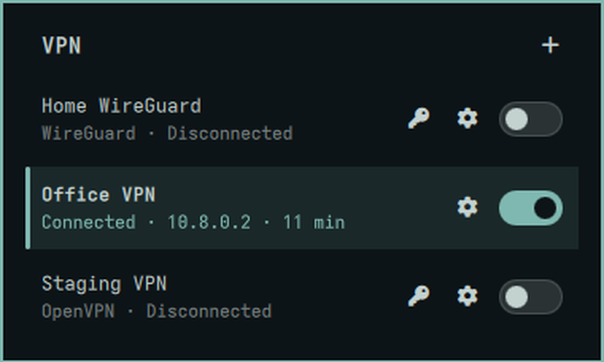
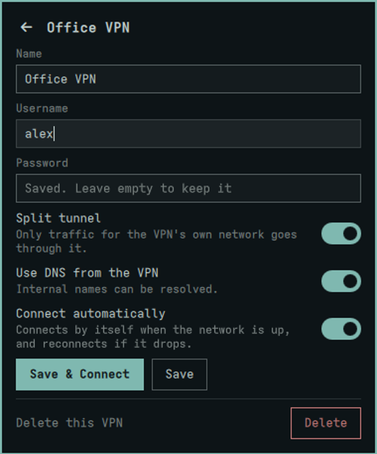
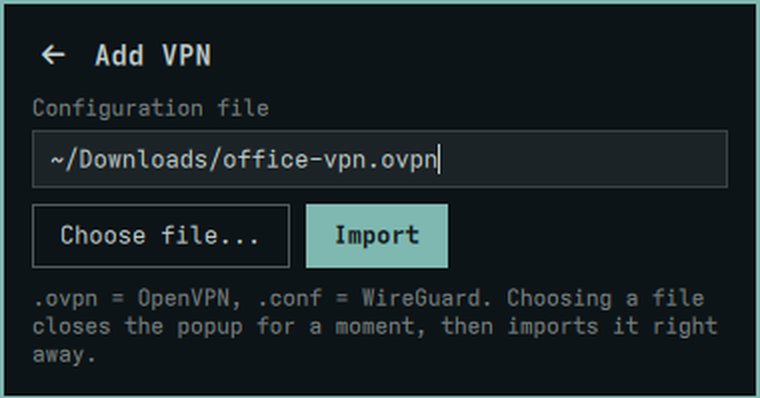

# Conduit

**A VPN manager for the [Omarchy](https://omarchy.org) bar.** See every VPN NetworkManager knows about, switch them on and off, import and delete profiles, keep logins saved, and let the ones you choose connect by themselves.

Works with **OpenVPN** (`.ovpn`) and **WireGuard** (`.conf`) through NetworkManager. No daemon, no extra service: it is a bar widget plus a popup, and it talks to `nmcli`.

> The popup follows the language you pick under Omarchy's **Setup > Language**. English and Indonesian are included; adding another is one small JSON file (see [CONTRIBUTING.md](CONTRIBUTING.md#translations)).

## Screenshots

<table>
  <tr>
    <td align="center"></td>
    <td align="center"></td>
    <td align="center"></td>
  </tr>
  <tr>
    <td align="center">The list</td>
    <td align="center">A VPN's settings</td>
    <td align="center">Importing a profile</td>
  </tr>
</table>

The screenshots use made-up data.

## Features

- **One list for all VPNs**, with live status. A connected VPN shows its address and how long it has been up (`Connected · 10.8.0.2 · 11 min`).
- **Switch on/off** from the popup, or right-click the bar icon for a quick toggle.
- **Import** a `.ovpn` / `.conf` with a file picker or a path. A duplicate name gets `-2`, `-3`, ... and new VPNs start as **split tunnel**.
- **Per-VPN settings**: name, username, saved password, "only for the office network" (split tunnel), "use DNS from the VPN", **auto-connect**.
- **Save & Connect** in one click, reconnecting if the VPN is already up.
- **One-time password / OTP** from the popup (the key icon), never saved.
- **Auto-connect and auto-reconnect**, plus a **notification when a VPN drops**. A VPN you switch off yourself stays off, and a rejected login is not retried in a loop.
- **Delete** a VPN with a two-step confirmation.
- Failures say why (for example "login rejected by the server") instead of a bare error.
- Everything is addressed by **UUID**, so profiles with the same name do not get mixed up.

## Requirements

- Omarchy with shell plugins (the `omarchy plugin` command).
- NetworkManager (`nmcli`), which Omarchy ships.
- `networkmanager-openvpn` for `.ovpn` profiles.
- `zenity` for the file picker (optional, you can type a path instead).

## Install

```bash
# Packages you may be missing (skip what is already installed)
omarchy pkg add networkmanager-openvpn zenity

# Install and enable the widget
omarchy plugin add https://github.com/andriar/omarchy-conduit.git --enable
```

The widget lands on the right side of the bar. Move it wherever you like:

```bash
omarchy bar move conduit.vpn --after omarchy.network
```

Update and remove:

```bash
omarchy plugin update conduit.vpn
omarchy plugin remove conduit.vpn
```

Your VPN profiles live in NetworkManager and are not touched when you remove the widget. Auto-connect choices are kept in `~/.local/state/omarchy-conduit/autoconnect` (delete that folder to forget them).

### Manual install

```bash
git clone https://github.com/andriar/omarchy-conduit.git ~/.config/omarchy/plugins/conduit.vpn
omarchy plugin enable conduit.vpn
```

## Using it

1. Click the shield icon in the bar to open the list.
2. **+** imports a profile. **Choose file...** closes the popup for a moment (the file dialog takes focus), imports the file straight away and reopens on the new VPN's settings.
3. In the settings, fill in the username and password and press **Save & Connect**.
4. The gear opens a VPN's settings, the key icon connects with a one-time password, the switch connects or disconnects.

Open the popup from a keybinding: `omarchy-shell conduit.vpn toggle`.

## Security and privacy

- Passwords you save are stored **by NetworkManager** in `/etc/NetworkManager/system-connections/` (readable by root only). This widget does not keep them anywhere else.
- Saving a password runs `nmcli ... vpn.secrets password=...`, so it is briefly visible in the process list to other processes of the same user. That is a limit of `nmcli`.
- A one-time password goes through a private (`0600`) temporary file in `$XDG_RUNTIME_DIR` that is deleted right after use. It never appears on a command line.
- The widget makes **no network requests** of its own. Everything is local `nmcli`, `journalctl` and `notify-send` calls.
- Omarchy shell plugins run **unsandboxed**. Read the code before you install any plugin, including this one.
- Do not post `.ovpn` files or logs from your VPN in issues: they contain certificates and keys.

## Troubleshooting

| Symptom | Likely cause |
|---|---|
| "Login rejected by the server" (`AUTH_FAILED` in the log) | Wrong username, password or OTP. Check the gear, or use the key icon for a one-time password. |
| Import fails with `unsupported blob/xml element` | The `.ovpn` uses a `<connection>` block, which NetworkManager's importer does not support. Move its `remote`/`proto` lines to the top level, or ask for a different profile. |
| Nothing in the list | Install `networkmanager-openvpn` (for OpenVPN) and check `nmcli connection show`. |
| The popup closed after picking a file | By design: the dialog takes focus. It reopens on the new VPN's settings. |
| VPN connects but websites do not open | Turn off "use DNS from the VPN", or turn split tunnel on. |

## Roadmap

- More translations (see CONTRIBUTING).

## Contributing

`main` is protected: open a pull request. Run `scripts/check.sh` before you push (CI runs the same script). See [CONTRIBUTING.md](CONTRIBUTING.md).

## License

[MIT](LICENSE)

---

## Instalasi singkat (Bahasa Indonesia)

```bash
omarchy pkg add networkmanager-openvpn zenity
omarchy plugin add https://github.com/andriar/omarchy-conduit.git --enable
```

Klik ikon perisai di bar, tekan **+** untuk impor file `.ovpn`, isi username dan password, lalu **Simpan & Hubungkan**. Nyalakan **Sambung otomatis** di pengaturan VPN kalau mau tersambung sendiri dan sambung ulang saat putus. Password disimpan oleh NetworkManager, bukan oleh widget ini. Tampilan mengikuti bahasa di Omarchy (Setup > Language): pilih Bahasa Indonesia untuk teks Indonesia.
